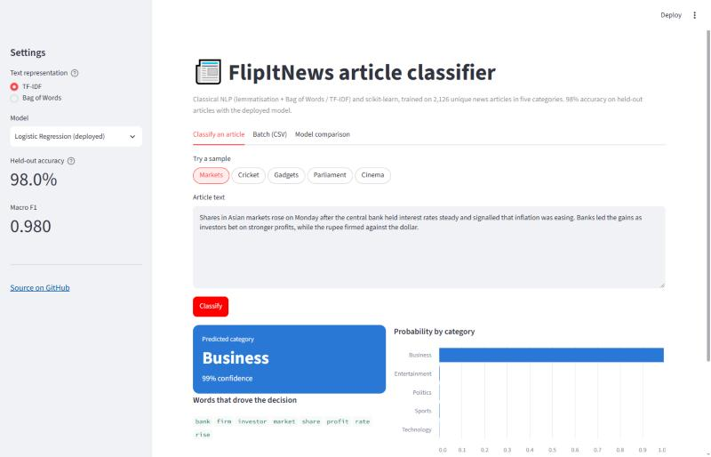
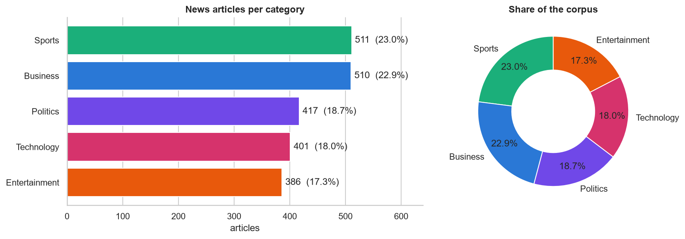
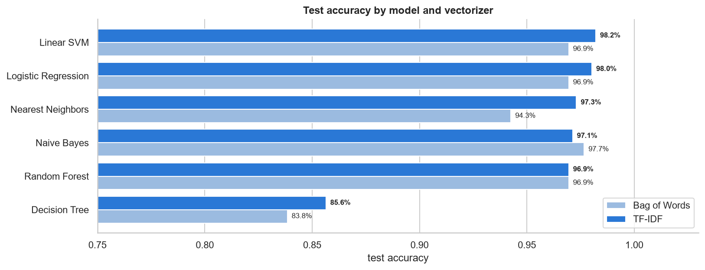
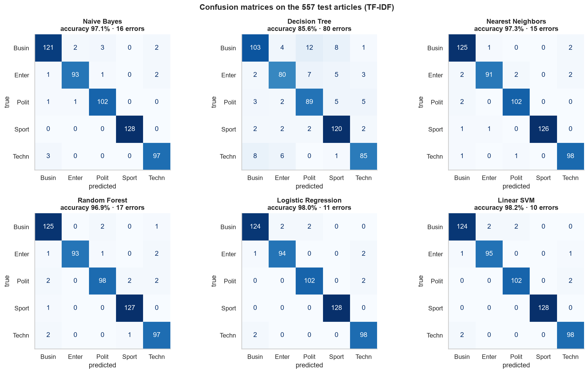
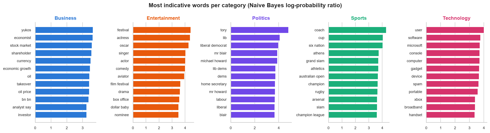

# 📰 FlipItNews: News Article Classification with NLP

**Sorts news articles into Business, Politics, Sports, Technology and Entertainment using classical NLP (lemmatisation + Bag of Words / TF-IDF) and six scikit-learn classifiers. Served through a REST API and a web app, packaged with Docker.**


| | |
|---|---|
| 📓 **Notebook** | [`notebooks/FlipItNews_News_Classification.ipynb`](notebooks/FlipItNews_News_Classification.ipynb): EDA, text processing, BoW / TF-IDF, 6 models, CV, leakage check, error analysis |
| 📄 **Report (PDF)** | [`docs/FlipItNews_NLP_GuntukuHariprasad.pdf`](docs/FlipItNews_NLP_GuntukuHariprasad.pdf): 25-page A4 submission with executive summary and questionnaire answers |
| 🔌 **REST API** | [`api/main.py`](api/main.py) (FastAPI): `POST /predict`, `GET /models`, `GET /health` |
| 🖥️ **Web app** | [`streamlit_app.py`](streamlit_app.py): paste an article, pick BoW or TF-IDF and a model, see the category and the words behind it |
| ✍️ **Blog post** | [`docs/blog.md`](docs/blog.md) |

<p align="center"></p>

---

## 1. Problem

FlipItNews (Gurugram) wants to make finance, business and markets easier to follow for millennials and first-time investors. Every article that enters the platform has to be filed under the right section before it can be recommended, searched or grouped with related stories. Doing that by hand does not scale.

**Goal:** predict an article's category from its text, and create and compare at least three models.
**Data:** 2,225 labelled articles (`Category`, `Article`), 2,126 of them unique.

| Category | Articles | Share |
|---|---|---|
| Sports | 511 | 23.0% |
| Business | 510 | 22.9% |
| Politics | 417 | 18.7% |
| Technology | 401 | 18.0% |
| Entertainment | 386 | 17.3% |

<p align="center"></p>

## 2. Approach

```
raw article ─► remove non-letters ─► word_tokenize ─► remove stopwords ─► POS-aware lemmatisation
                                                                                   │
  web app / REST API ◄── Logistic Regression ◄── 5-fold CV ◄── 6 models × {BoW, TF-IDF} ◄── vectorize (train only)
```

### 2.1 Text processing (one user-defined function, shared by notebook, API and app)

| Step | Example: "Former WorldCom boss Bernie Ebbers, accused of overseeing an $11bn fraud ..." |
|---|---|
| 1. Remove non-letters (lower-case, keep a-z) | `former worldcom boss bernie ebbers accused of overseeing an bn fraud` |
| 2. Tokenise (NLTK `word_tokenize`) | `[former, worldcom, boss, bernie, ebbers, accused, of, overseeing, an, bn, fraud]` |
| 3. Remove stopwords | `[former, worldcom, boss, bernie, ebbers, accused, overseeing, bn, fraud]` |
| 4. Lemmatise with part of speech | `[former, worldcom, boss, bernie, ebbers, accuse, oversee, bn, fraud]` |

The pipeline removes 44% of tokens (390 → 218 per article) and halves the vocabulary (43,771 → 23,140). Two details that a default setup gets wrong were caught by tests and fixed:

* **NLTK lists `won` as a stopword** (from *won't*), so "Arsenal **won** the match" lost its most informative word. It is kept.
* **WordNet strips a final "s" from `boss` and `us`** (`bos`, `u`). Words ending in *-ss / -us* are left as they are.

### 2.2 Features: the user chooses Bag of Words or TF-IDF

Both use the same vocabulary rules (unigrams + bigrams, `min_df=2`, `max_df=0.95`, top 5,000) and are **fitted on the training split only**. Set `VECTORIZER = "bow"` or `"tfidf"` in the notebook, pick it in the web app's sidebar, or pass `"vectorizer"` to the API.

### 2.3 Models

Stratified **75:25 split → train (1,668, 5,000), test (557, 5,000)**, `random_state=42`. Naive Bayes is trained the simple way first, then `train_and_evaluate()` ([`flipitnews/models.py`](flipitnews/models.py)) trains every model as a `Pipeline(vectorizer → model)` and records accuracy, macro precision / recall / F1, training time, latency and model size.

## 3. Results

| Model | BoW test acc. | TF-IDF test acc. | 5-fold CV acc. (best vec.) | Notes |
|---|---|---|---|---|
| **Logistic Regression** ⭐ deployed | 97.0% | **98.0%** | **97.8%** ± 0.5 | Calibrated probabilities, 0.4 MB, < 1 ms / article |
| Linear SVM | 97.0% | 98.2% | 97.7% ± 0.5 | Tied with LR, no probabilities |
| **Naive Bayes** (best of the 4 required) | 97.7% | 97.1% | 97.2% ± 0.5 | Trains in ~5 ms, fully interpretable |
| Nearest Neighbors (cosine, k=7) | 94.3% | 97.3% | 96.3% ± 0.3 | Needs TF-IDF; stores the whole training set |
| Random Forest (300 trees) | 97.0% | 97.0% | 96.1% ± 1.0 | ~15 MB, slowest |
| Decision Tree | 83.8% | 85.6% | 83.0% ± 1.5 | Over-fits single words |

<p align="center"></p>
<p align="center"></p>

### What the analysis found

* **TF-IDF is the better representation.** +3.1 points for Nearest Neighbors and about +1 for the linear models, at the same cost as BoW. Random Forest doesn't care, and Naive Bayes (designed for counts) is a tie within noise.
* **The scores are not inflated by duplicates.** 42 of the 557 test articles have an exact copy in training. Re-running on the 2,126 unique articles leaves Naive Bayes, Logistic Regression and the SVM unchanged (±0.2 points); only the memorising models drop (Decision Tree −2.0, Random Forest −1.1).
* **The remaining errors are genuinely ambiguous.** The deployed model makes 11 errors out of 557, for example McDonald's sponsoring an MTV show, MPs banned from using BlackBerrys in the Commons, or a UK pension overhaul. Business, the hub topic, is involved in 7 of them, and Sports in none.
* **Confidence can be trusted.** Sending articles with confidence < 0.6 to an editor (4.5% of traffic) catches 10 of the 11 errors; the other 95.5% are filed at **99.8% accuracy**.
* **Watch for drift.** The strongest features include 2004-05 British names (*Yukos, Mr Blair, Michael Howard*). An Indian cricket report is still classed as Sports, but at only 51% confidence. Retraining on FlipItNews's own articles is the first step before production.

<p align="center"></p>

## 4. Run it

```bash
python -m venv .venv && .venv/Scripts/activate      # source .venv/bin/activate on Linux / macOS
pip install -r requirements-dev.txt
python scripts/train.py                             # ~1 min: cleans text, trains 10 pipelines, writes models/
pytest -q                                           # 28 tests
```

**API**

```bash
uvicorn api.main:app --port 8000                    # docs at http://localhost:8000/docs
curl -X POST localhost:8000/predict -H "Content-Type: application/json" \
     -d '{"texts": ["The Reserve Bank held the repo rate as inflation eased and bank shares rallied."],
          "model": "naive_bayes", "vectorizer": "bow"}'
```

```json
[{"category": "Business", "confidence": 1.0,
  "probabilities": {"Business": 1.0, "Politics": 0.0, "Technology": 0.0, "Sports": 0.0, "Entertainment": 0.0},
  "top_terms": [{"term": "bank", "weight": 6.86}, {"term": "inflation", "weight": 5.09}, {"term": "rate", "weight": 2.89}],
  "model": "naive_bayes__bow", "tokens_used": 8}]
```

**Web app:** `streamlit run streamlit_app.py`

**Docker (API on :8000, web app on :8501)**

```bash
docker compose up --build
```

**Rebuild the notebook and the PDF**

```bash
cd tools && python run_nb.py FlipItNews_News_Classification && python build_report.py
```

## 5. Repository layout

| Path | Contents |
|---|---|
| `flipitnews/preprocess.py` | Text processing: non-letters, tokens, stopwords, POS-aware lemmas |
| `flipitnews/models.py` | Vectorizer choice, model zoo, `train_and_evaluate()` |
| `flipitnews/inference.py` | Loads the model bundle; predictions, probabilities, top words |
| `src/` → `notebooks/` | Notebook source (percent format) and the executed notebook |
| `scripts/train.py` | Trains and saves the 10 served pipelines and the model card |
| `api/`, `streamlit_app.py` | FastAPI service and Streamlit web app |
| `models/` | `flipitnews_classifiers.joblib` (12.9 MB) and `model_card.json` |
| `reports/figures/` | Every chart in the notebook |
| `report/`, `tools/` | Report template and builders (notebook → PDF) |
| `tests/` | Preprocessing, model and API tests |
| `Dockerfile`, `docker-compose.yml`, `.github/workflows/ci.yml` | Container and CI (tests, image build, container smoke test) |

## 6. Limitations and next steps

* The corpus is British news from 2004-05. Retrain on FlipItNews's own articles and add finance sub-categories (markets, personal finance, startups).
* Some stories belong to two sections. Show the top two categories when confidence is low, or move to multi-label tagging.
* A fine-tuned transformer (e.g. DistilBERT) might recover a few of the 11 errors, at about 100x the inference cost. That is not justified at 98% accuracy with a review rule.

## Author

**Guntuku Hariprasad**, Scaler Academy business case (NLP). [GitHub](https://github.com/dot-hpg)
